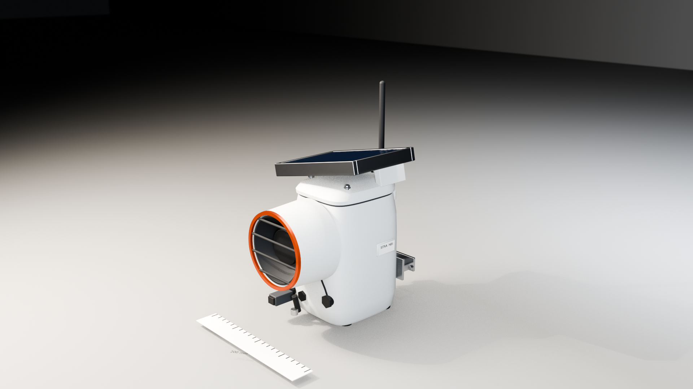
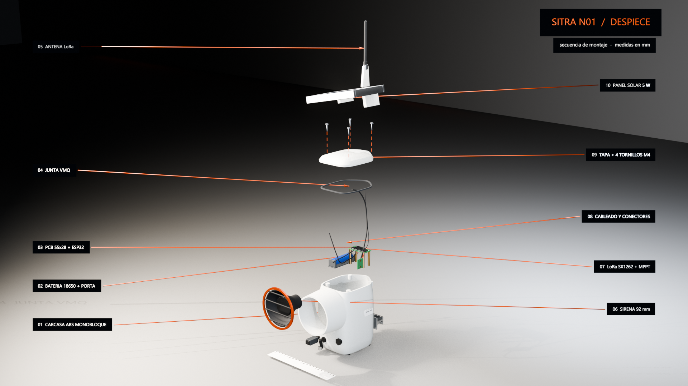
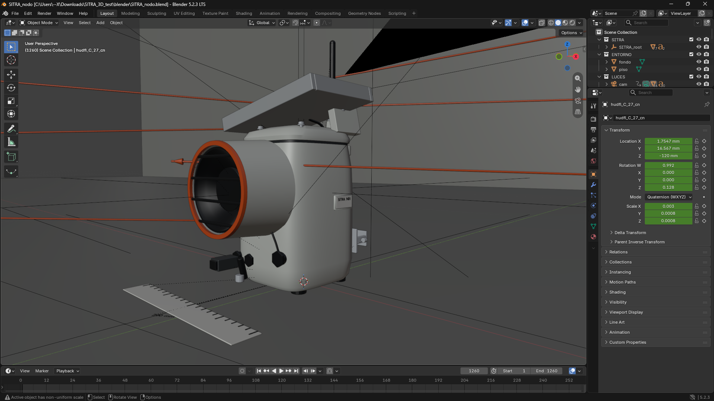
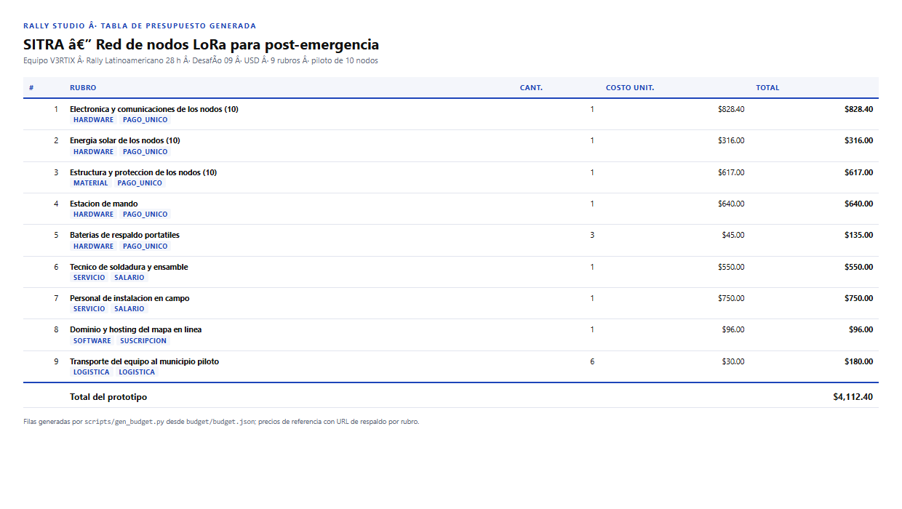

# Rally Studio · Tu Copiloto para el Rally de Innovación

[](#)
[](#)
[](#el-mapa-de-conocimiento)
[](#el-equipo-de-asistentes-el-dream-team-del-desvelo)
[](#del-diseño-3d-al-presupuesto-en-excel)

> **Un espacio de trabajo creado por un estudiante universitario que ya vivió y ganó un rally, diseñado para ayudar a otros equipos a no perder la cabeza en maratones de 24h y 28h (Rally Latinoamericano y Rally Nacional Nicaragua Innova). No te promete ganar por arte de magia, pero te ahorra horas de caos, organiza a tu grupo y evita que te descalifiquen por un error tonto.**

---

<div align="center">


*Figura 1: Rally Studio — Tu centro de control durante el rally: organiza los retos, redacta la propuesta, calcula los costos y arma el guion en un solo lugar.*

</div>

---

## ⚡ Inicio Rápido (En 1 minuto)

```powershell
# 1. Instala los requerimientos básicos (Python 3.10+)
pip install -r requirements.txt

# 2. Inicia el sistema (o haz doble clic en "Iniciar Rally.bat")
.\iniciar_rally.ps1
```
Abre en tu navegador en: **<http://localhost:8000/dashboard/>**

> ⚠️ **Aviso de transparencia:** Este es un proyecto independiente desarrollado por un estudiante universitario basado en su experiencia en competencia. **No es una herramienta oficial de ninguna universidad, comité organizador ni institución.**

---

## ¿Por qué te ayuda durante la competencia?

1. **Prompts listos y testeados:** No pierdes tiempo a las 3:00 AM pensando qué preguntarle a ChatGPT o Claude; el sistema ya tiene las plantillas listas con las palabras exactas y límites de la competencia.
2. **Conoce las reglas de los dos certámenes:**
   - **Rally Latinoamericano (28h):** Presupuesto en **dólares (USD)**, enfoque regional y soluciones aplicables a toda América Latina.
   - **Rally Nacional Nicaragua Innova (24h):** Presupuesto en **córdobas (C$)** con tasa oficial del BCN, anclado a municipios y necesidades del país.
3. **Modelos 3D y presupuesto real:** Conecta piezas reales con Blender para sacar renders y despieces que justifican cada peso que pones en la tabla.
4. **Historial de ganadores:** Consulta proyectos de años anteriores y cómo evalúan los jueces para no tropezar con ideas que ya fracasaron.
5. **Guardas contra descalificación:** Te avisa si tu video pasa de 120 segundos, si lo pusiste en privado en YouTube o si las cifras del documento no cuadran con el presupuesto.

---

## El Mapa de Conocimiento

<div align="center">


*Figura 2: Mapa de consulta con proyectos premiados de años anteriores, rúbricas de evaluación y antecedentes de solución.*

</div>

En lugar de carpetas con documentos sueltos que nadie lee a medianoche:
- Revisa cómo resolvieron problemas técnicos otros equipos universitarios en ediciones anteriores.
- Puedes explorar el mapa interactivo en cualquier momento abriendo [`graphify-out/graph.html`](graphify-out/graph.html).

---

## Las 13 Etapas del Rally, Paso a Paso

```
[00 Certamen] ──> [01 Equipo] ──> [02 Retos] ──> [03 Solución] ──> [04 Impacto/ODS]
                                                                          │
[09 Canvas]   <── [08 Recursos]<── [07 Budget] <── [06 Pautado] <── [05 Multi-IA]
     │
     └──> [10 Guion 120s] ──> [11 Web Demo] ──> [12 Checklist Final] ──> ¡A tiempo!
```

<div align="center">


*Figura 3: Pantalla principal — las 13 etapas organizadas para ver qué falta hacer y quién se encarga de cada parte.*

</div>

<div align="center">


*Figura 4: Inicio y cronómetro — eliges si compites en el Latinoamericano (28h) o en el Nacional (24h) y controlas el tiempo restante.*

</div>

<div align="center">


*Figura 5: Cómo te asisten las IAs — te hacen sugerencias en pantalla y tú decides si las aceptas o descartas con un botón.*

</div>

---

## El Equipo de Asistentes (El Dream Team del Desvelo)

Cada asistente tiene un trabajo puntual para que tu equipo se reparta la carga:

| Asistente | Nombre de Guerra | Qué hace por ti |
|---|---|---|
| `guiar-usuario` | **Tu Última Neurona** | Te acompaña paso a paso por las 13 etapas para que no te pierdas a las 4 AM. |
| `orquestador` | **El Admin del Grupo** | Reparte las tareas y cuida que tu computadora no se pegue con procesos pesados. |
| `sharktank` | **El Destructor de Sueños** | Analiza tu idea con total sinceridad: busca si ya existe en otro país o qué fallas tiene antes de que pierdas 10 horas. |
| `auditar-entregable` | **La Tóxica que Revisa el Chat** | Busca cualquier contradicción en los números del documento o límites de palabras y te avisa a tiempo. |
| `presupuesto` | **Don Cangrejo (El Palmado)** | Cotiza componentes reales con proveedores y enlaces para que el jurado verifique los precios. |
| `modelo-3d-blender` | **El Quemador de Tostadas** | Arma el modelo 3D y las imágenes para el video basándose en la lista de materiales. |
| `dossier-soluciones` | **Labia Interna** | Estructura propuestas lógicas y creíbles (problema, causa, idea y cómo medirla). |
| `proponer-retos` | **La Ruleta Rusa** | Lee los retos que publica el comité y ayuda al grupo a descartar los más complicados. |
| `ingestar-investigacion`| **La Chismosa del Barrio** | Busca datos y estadísticas oficiales con fuente y año para respaldar el impacto. |
| `contexto-rally` | **San Google de los Ganadores** | Recuerda las reglas oficiales y ejemplos ganadores anteriores para no inventar ruedas cuadradas. |
| `publicar-sitio` | **El del Ciber del Barrio** | Te ayuda a subir la página web de demostración para que el jurado la pueda abrir desde su teléfono. |
| `servir-a-ventana` | **PedidosYa** | Te muestra las sugerencias en pantalla para que solo tengas que darle a "Aceptar" o "Descartar". |
| `sugerir-por-fase` | **Café Presto con Ansiedad** | Te recuerda cuánto tiempo queda en el reloj para que no dejes todo a última hora. |
| `propuesta-identidad` | **El Diseñador de Carretera Masaya** | Te ayuda a elegir colores y letras que se vean limpias y fáciles de leer. |

---

## Del Diseño 3D al Presupuesto en Excel

En lugar de buscar fotos al azar en internet, el sistema conecta los materiales que vas a cotizar con un modelo 3D:

<div align="center">



*Figura 6: Ejemplo de render 3D con medidas reales para mostrar en el video.*

</div>

<div align="center">



*Figura 7: Vista desarmada del prototipo para explicarle claramente al jurado cómo se construye por dentro.*

</div>

<div align="center">



*Figura 8: El modelo abierto en Blender listo para animar o exportar imágenes.*

</div>

<div align="center">



*Figura 9: Hoja de presupuesto con precios reales y enlaces a proveedores para que el jurado verifique cada costo.*

</div>

---

## ¿En qué certamen vas a competir?

| Certamen | Tiempo | Moneda | Enfoque Principal |
|---|:---:|:---:|---|
| **Rally Latinoamericano** | **28 h** | **Dólares (USD)** | Solución replicable en varios países de la región, técnica clara y modelo sostenible. |
| **Rally Nacional (Nicaragua Innova)** | **24 h** | **Córdobas (C$)** | Aplicado a un municipio real de Nicaragua y conectado con las necesidades locales. |

---

## Hecho para cuando el internet de la universidad falla

- **Funciona sin internet:** Si se cae el WiFi del campus durante la madrugada, el sistema guarda todo en tu navegador y en tu computadora.
- **Comparte en red local:** Puedes compartir el espacio con tus compañeros de equipo mediante un enlace sencillo (`python scripts/crear_proyecto.py`).
- **Respaldo en USB:** Puedes guardar todo el proyecto en un archivo `.json` liviano para pasarlo por memoria USB cuando quieras.

---

## Llevar el contenido a otra IA (prompts listos)

Cada skill de Rally Studio trae un bloque "Generación de prompts para llevar el contenido a otra IA" con la estructura lista para copiar y pegar en OpenAI, Claude, Gemini, OpenCode o Antigravity. Cada prompt incluye:

- **Rol:** quién debe ser la IA (guionista, modelador 3D, diseñador, presupuestador, auditor…)
- **Contexto:** certamen, horas, proyecto, equipo, ciudad, reto.
- **Entrada:** los archivos de origen exactos (`brief.json`, `budget/budget.json`, `brand/palette.json`, `research/claims.json`, etc.).
- **Tarea:** qué debe hacer la IA con ese contenido.
- **Restricciones:** límites del certamen, prohibiciones de estilo (sin emojis, sin morado, sin glassmorphism, sin cards), contraste WCAG, fuentes solo de `brand/tokens.css`.
- **Formato de salida:** JSON con claves nombradas.
- **Idioma:** español.

Ejemplo rápido (guion a otra IA):

```
Rol: guionista de pitch de innovación, especialista en locución y pronunciación en español.
Contexto: Rally de innovación, certamen latam (28 h), acto 3, duración objetivo 40 s.
Entrada: script/script.md, budget/budget.json, research/claims.json.
Tarea: Escribir el acto 3 (Solución) del guion PAS-V, cuidando pronunciación, orden de palabras y flujo de ideas.
Restricciones: ≤ 120 s de audio; números coinciden con budget/budget.json; cada dato de research/claims.json; sin emojis; cierre: "piloto en [ciudad], replicable en toda América Latina".
Formato de salida: JSON con claves acto, nombre, duracion_s, texto, palabras_estimadas, wpm, numeros_coherentes, claims_usados, cierre_certamen.
Idioma: español.
```

---

## Sugerir un título o nombre de proyecto o producto

Sigue los patrones reales del banco SIRLI (`research/sirli/winners.jsonl`):

- **Inventado:** NEXORA, KINETIX
- **Objeto:** AVOCADO, LUMBRE
- **Compuesto:** NEXO-SOSTENIBLE
- **Territorio + número:** ALTIPLANO 360
- **Sufijo técnico:** BIOINNOVATECH
- **Juego:** DESUCHO, ERROR 404

Reglas:
- Nunca repites el nombre del proyecto más de una vez por sección.
- No hardcodees el nombre en scripts; léelo siempre de `brief.json`.
- El nombre debe entenderse fuera del país (Latam) o tener arraigo cultural (Nacional).
- El nombre no va en los primeros 20 s del video.

---

## Enseñar visualmente (materiales didácticos y elementos gráficos)

- Una sola distancia focal por secuencia con rótulos.
- Antes de dar por bueno un rótulo, mídelo: proyecta su caja a coordenadas de pantalla (u,v) y comprueba que queda dentro del cuadro con margen ≥6 %.
- Contraste garantizado: texto claro emisivo sobre placa oscura propia, o sombra de texto desplazada. Nunca texto gris sobre fondo iluminado.
- Un rótulo sin flecha que apunte a la pieza no dice nada.
- Varios rótulos en el mismo lado se pisan: lleva un registro por lado y reubica el siguiente candidato vertical hasta que no choque.
- Tipografía: regular antes que bold (el bold a 540p embota los acentos), acentos reales en español, tamaño ≥2 % de la altura del cuadro.
- Thumbnail y piezas de portada: prohibido resolver con cuadrados, rectángulos, círculos o triángulos. Usa foto real, vector complejo o un modelo de Blender.
- La imagen del thumbnail muestra el reto ya resuelto y su impacto, no decoración.
- Prioriza foto real de la problemática y del reto sobre ilustración o render.
- La imagen no lleva texto, logos ni marcas de agua: el texto lo pone la plantilla.
- Elementos gráficos se exportan como PNG 2048×2048 con fondo transparente.
- Sin emojis como íconos en la web demo.
- Sin cards genéricas, sin morado (#7c3aed o similar), sin fuentes fuera de `brand/tokens.css`.
- Nombrado de assets: `asset_<shotlist_id>_<descripcion>.<ext>`.

---

## Redactar guiones cuidando la pronunciación, el orden de palabras y las ideas

- Escribe para ser escuchado, no leído: oraciones cortas, sujeto-verbo-objeto, evita subordinadas encajadas.
- Acentos reales en español; acrónimos se deletrean si no son de uso común.
- Cada cambio de idea necesita una pausa o transición explícita.
- Máximo 240-270 palabras (≈130-140 WPM) para ≤ 120 s de audio.
- Los números se dicen completos ("cuatro mil quinientos", no "4.500" leído en voz alta).
- No repitas el nombre del proyecto más de una vez por sección del pautado.
- Coherencia total: los números del guion coinciden exactamente con `budget/budget.json`.
- Cada dato o porcentaje proviene de `research/claims.json`.
- Cierre según certamen: Nacional → municipio + Plan Nacional/ODS; Latam → "piloto en [ciudad], replicable en toda América Latina".

---

## Crear modelos 3D (Blender)

La skill `modelo-3d-blender` genera modelos o renders 3D con Blender para el video, con ficha técnica previa justificada por la rúbrica. Resumen del procedimiento:

1. **Confirma la toma:** lee tu fila en `script/shotlist.csv` (rubric_item, quality_tier, depends_on, duración).
2. **Compila los contratos:** `python scripts/build_shotlist.py` sin errores.
3. **Busca antes de modelar:** modelos CC0 (Poly Haven, Kenney) o del proyecto.
4. **Escribe la ficha:** `blender/ficha_<shot_id>.md`, aprobada por el director antes de reservar GPU.
5. **Toma el guardia:** `python scripts/gpu_lock.py run --owner modeler_<pieza> --priority media -- <comando>`.
6. **pre_render_check:** `python scripts/pre_render_check.py <shot_id>` debe salir 0.
7. **Modela con script reproducible**, no a mano. Dimensiones desde `budget/bom.csv` (dim_*_mm).
8. **Renderiza en el tier de la toma:** draft EEVEE 50 % ≤5 min; revisar EEVEE 100 % ≤20 min; final Cycles solo pasado ~75 % del tiempo.
9. **Bucle de crítica (máx. 2 vueltas):** render revisar, lista en la ficha qué no se lee en cámara y corrige.
10. **Auditoría geométrica:** nada atraviesa ni se superpone; ningún componente interno sale de su contenedor.
11. **Entrega:** `dashboard/assets/` como `asset_<shotlist_id>_<descripcion>.<ext>`, servir a la ventana (`--tab resources --slot main`), anotar minutos en `blender/horas_3d.csv`.

---

## Los 16 asistentes (skills)

Cada asistente tiene un trabajo puntual y ahora incluye bloques de: **prompts para otra IA**, **nombrado de proyecto**, **enseñanza visual**, **guion con pronunciación**, **modelos 3D** y **elementos gráficos**.

| Asistente | Nombre de Guerra | Qué hace por ti |
|---|---|---|
| `guiar-usuario` | Tu Última Neurona | Te acompaña paso a paso por las 13 etapas. |
| `orquestador` | El Admin del Grupo | Reparte tareas y cuida que no se pegue la computadora. |
| `sharktank` | El Destructor de Sueños | Analiza tu idea con sinceridad: fallas, riesgos, patentes. |
| `auditar-entregable` | La Tóxica que Revisa el Chat | Revisa entregables contra la rúbrica sin reescribir. |
| `presupuesto` | Don Cangrejo (El Palmado) | Cotiza componentes con precios creíbles y enlaces. |
| `modelo-3d-blender` | El Quemador de Tostadas | Modela y renderiza en Blender para el video. |
| `dossier-soluciones` | Labia Interna | Estructura propuestas problema → causa → insight → solución → métrica. |
| `proponer-retos` | La Ruleta Rusa | Genera soluciones para retos del comité con precedentes. |
| `ingestar-investigación`| La Chismosa del Barrio | Procesa PDF/DOCX/MD externos y los alinea a la rúbrica. |
| `contexto-rally` | San Google de los Ganadores | Carga contexto del proyecto antes de trabajar. |
| `publicar-sitio` | El del Ciber del Barrio | Sube la web demo a GitHub Pages o Netlify. |
| `servir-a-ventana` | PedidosYa | Entrega propuestas a la interfaz (Aceptar / Descartar). |
| `sugerir-por-fase` | Café Presto con Ansiedad | Sugerencias cortas por etapa del flujo. |
| `propuesta-identidad` | El Diseñador de Carretera Masaya | Paleta, tipografías, tokens, dirección de logotipo. |
| `control-tiempo-entrega` | — | Cronómetro, congelamiento al 75 %, checklist SIRLI. |
| `brainstorming` | — | Lluvia de ideas antes de crear funcionalidad nueva. |
