<div align="center">
  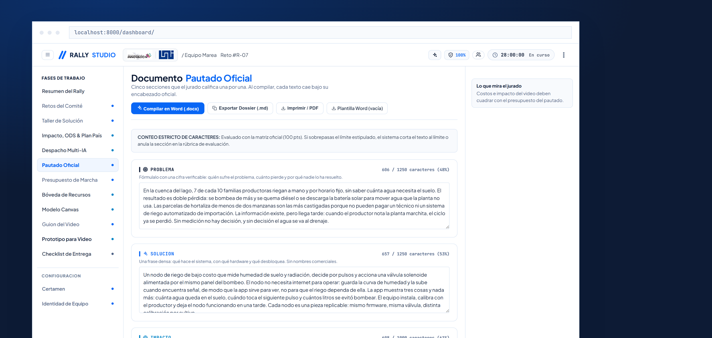
</div>

# Rally Studio

**El workbench local donde un rally de innovación se termina.** Trece etapas, dieciocho asistentes y un solo estado compartido: el pautado con conteo de caracteres, el presupuesto con proveedor, el guion de 120 segundos y el render 3D salen del mismo lugar, no de cinco pestañas distintas a las tres de la mañana.

<p align="center">
  
  
  
  
  
</p>

> Lo construyó un estudiante que ganó un rally y no quería volver a perder un certamen por un número desincronizado entre el PDF y el video.

**Qué deja de pasar:** el presupuesto del documento no coincide con el del video. El pautado se pasa de caracteres y nadie lo nota. El guion dura 140 segundos. La web demo se cae el día de la entrega. Y a las 2 a.m. alguien pregunta "¿quién tiene la última versión el canvas?".

**Qué hay en su lugar:** una etapa no se abre si el entregable no existe, las cifras se cruzan solas entre archivos y cada pieza tiene un dueño con nombre.

---

## El workbench, en movimiento

<div align="center">
  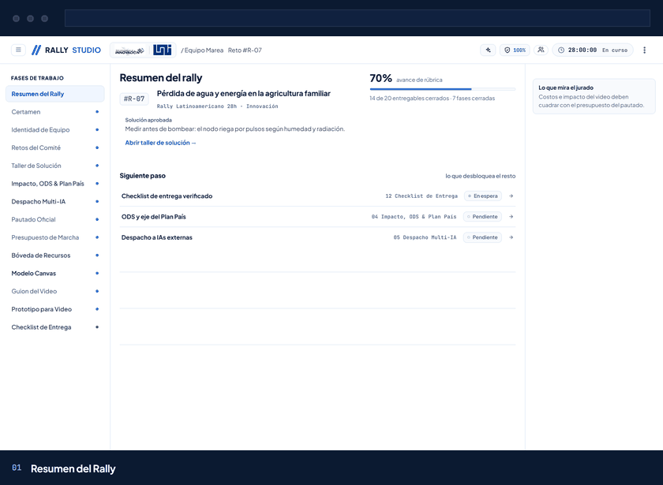
</div>

Cada pantalla es una etapa real, con el estado del proyecto demo de ejemplo: reto `#R-07`, cinco secciones de pautado dentro del tope, presupuesto de `$5,760 USD` y checklist en `8/10`.

---

## Del reto al video, sin saltos

<div align="center">
  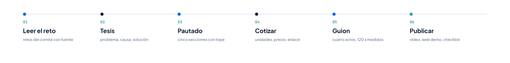
</div>

Cada eslabón deja un archivo verificable, y el sistema cruza las cifras entre ellos **antes** de que las vea el jurado.

---

## Trece etapas, un solo hilo

<div align="center">
  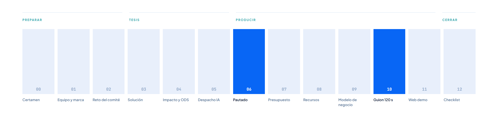
</div>

La etapa siguiente se abre cuando el entregable existe. Si falta, la app lo dice y no deja avanzar: el pestillo es la rúbrica, no la buena voluntad.

---

## Dieciocho asistentes, cada uno con su oficio

<div align="center">
  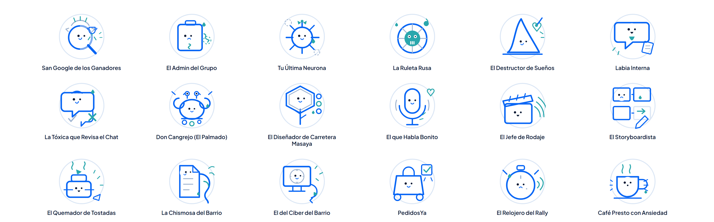
</div>

Se invocan a demanda desde `skills/` y se reflejan en `.opencode/skills` y `.agents/skills`. Investigan, cotizan, auditan y rompen la idea antes de que lo haga el jurado.

<details>
<summary><b>Quién hace qué</b></summary>

| Oficio | Asistente | Qué entrega |
|---|---|---|
| Contexto | San Google de los Ganadores | Lee brief, corpus y estado de la ventana |
| Coordinación | El Admin del Grupo | Reparte trabajo en paralelo sin choques |
| Ruta | Tu Última Neurona | Dice qué etapa sigue y qué falta |
| Retos | La Ruleta Rusa | Convierte retos del comité en soluciones |
| Crítica | El Destructor de Sueños | Rompe la idea: patentes, competencia, agujeros |
| Dossier | Labia Interna | Tres páginas por reto, con precedentes |
| Auditoría | La Tóxica que Revisa el Chat | Revisa contra la rúbrica del certamen activo |
| Dinero | Don Cangrejo (El Palmado) | Partidas con unidades, precio y enlace |
| Marca | El Diseñador de Carretera Masaya | Paleta, logo y tokens de diseño |
| Guion | El que Habla Bonito | Pitch PAS-V calibrado a 120 s |
| Rodaje | El Jefe de Rodaje / El Storyboardista | Guion y plan de tomas en un solo HTML |
| 3D | El Quemador de Tostadas | Modela, audita y renderiza en Blender |
| Investigación | La Chismosa del Barrio | Procesa el PDF o DOCX que traes de fuera |
| Publicación | El del Ciber del Barrio | Web demo en GitHub Pages o Netlify |
| Interfaz | PedidosYa | Sirve propuestas a la ventana como Aceptar/Descartar |
| Reloj | El Relojero del Rally | Cronómetro, avisos y congelado al 75 % |
| Mejora | Café Presto con Ansiedad | Sugerencias cortas por etapa |

</details>

---

## Lo que sale de una corrida real

<div align="center">
  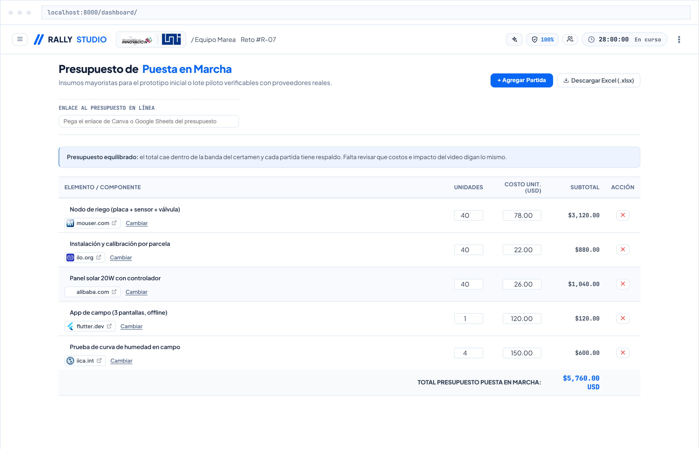
  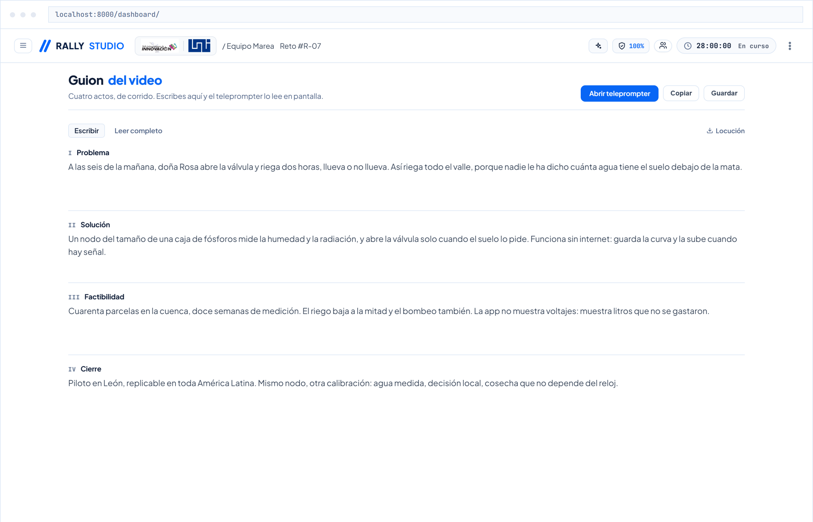
</div>

Presupuesto con unidades, precio unitario y enlace de respaldo, sin TIR ni VAN que nadie va a leer. Guion en cuatro actos medido sobre el audio, no sobre la página.

*Proyecto demo `[SIMULADO]`: el reto, la solución y las cifras son de ejemplo. La app, el conteo, el cruce de cifras y el render son reales.*

---

## Se ve en el escritorio y en el teléfono

<div align="center">
  <table>
    <tr>
      <td width="70%">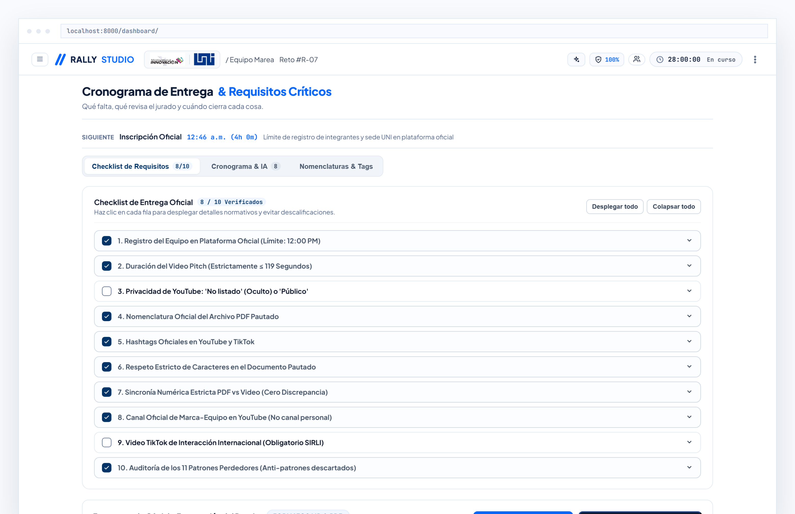</td>
      <td width="30%">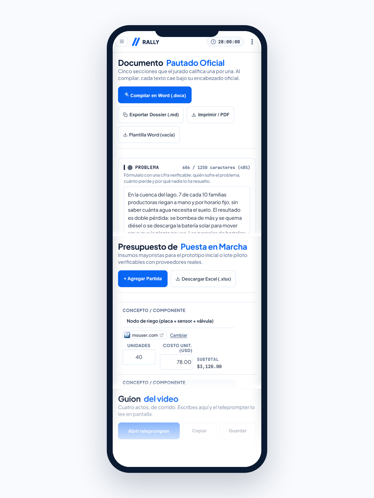</td>
    </tr>
    <tr>
      <td align="center"><sub><b>Escritorio.</b> Checklist de entrega: qué falta, quién lo revisa y cuándo cierra.</sub></td>
      <td align="center"><sub><b>Teléfono.</b> PWA, sin tienda: se instala desde el navegador.</sub></td>
    </tr>
  </table>
</div>

---

## El cerebro: todo lo que ya ganó

<div align="center">
  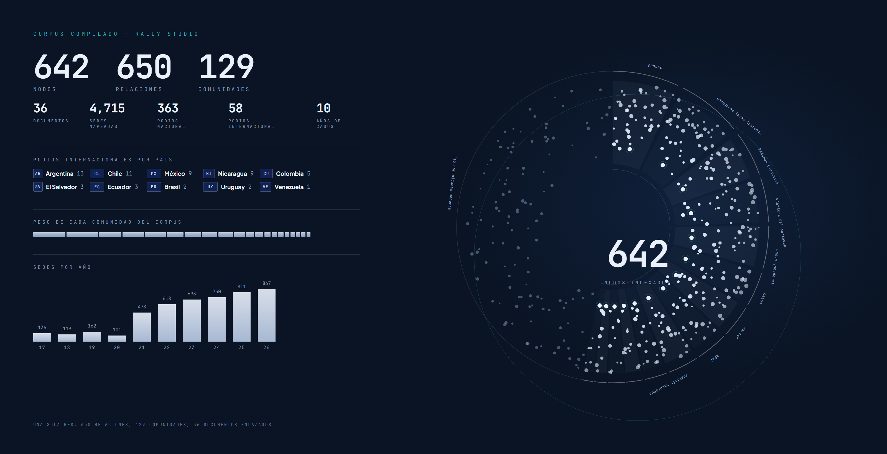
</div>

Rúbricas de los dos certámenes, casos ganadores, claims con fuente, anatomía del pitch y patrones que el jurado premia: **420 nodos, 732 aristas, 29 comunidades** compiladas en `graphify-out/`. Se consulta sin subir el proyecto a ninguna nube.

<div align="center">
  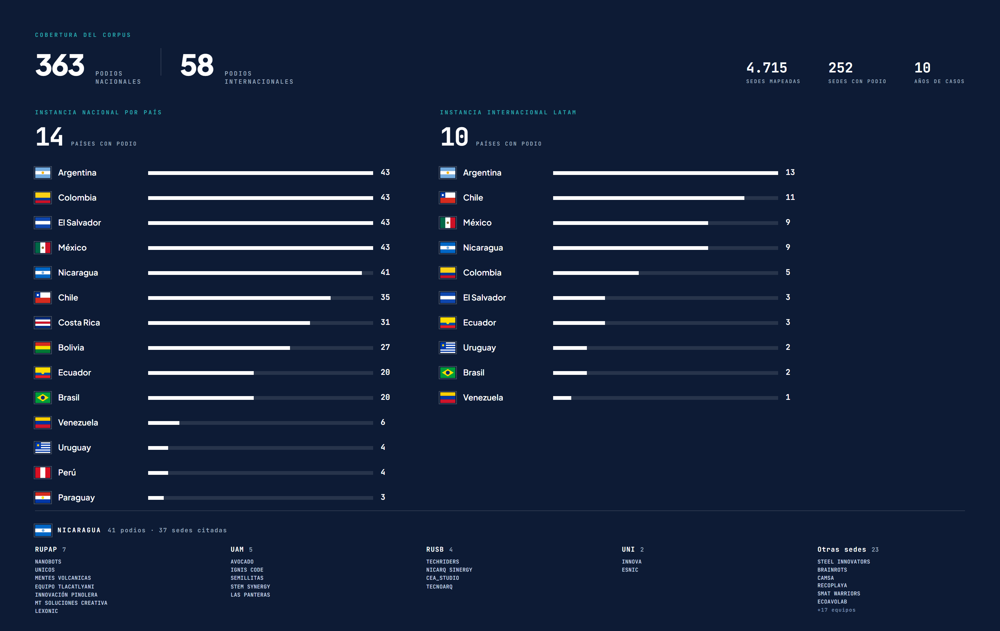
</div>

**4.715 sedes** mapeadas, **363 podios nacionales**, **58 internacionales** en diez países y **diez años** de casos. No es una lista de ideas: es lo que ya ganó, con año, equipo y sede.

---

## 3D con ficha técnica

<div align="center">
  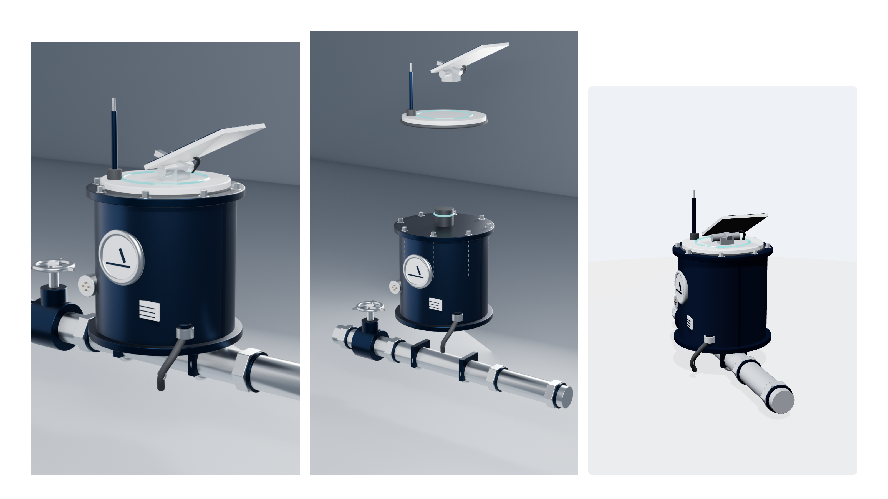
</div>

Cada pieza nace de una ficha aprobada —dimensiones desde el BOM, materiales y presupuesto de GPU— y se entrega en tres pasadas sobre la misma malla: **sólido** para vender, **despiece** para mostrar que el interior existe (placas, batería, cableado, prensaestopas) y **visor web** con el GLB exportado: el mismo archivo sirve para el render y para la página. Un render a la vez, con `gpu_lock`, tiers de calidad y `pre_render_check` antes de gastar la tarjeta.

---

## Arrancarlo

```powershell
pip install -r requirements.txt
.\iniciar_rally.ps1
```

Abre `http://localhost:8000/dashboard/`. La llave de acceso de la primera vez está en `dashboard/data/acceso.txt`; después se reparten invitaciones desde `admin.html`. Todo corre en tu máquina: sin cuenta, sin nube obligatoria.

```powershell
python smoke.py        # 6/6: ffmpeg, duración, caracteres, cifras, arsenal, brief
python arsenal.py check-todo   # antes de subir a SIRLI
```

---

## Dos certámenes, un mismo motor

| | Rally Latam · 28 h | Rally Nacional · 24 h |
|---|---|---|
| **Qué cambia** | Laboratorio piloto replicable en toda América Latina | Municipio real, eje del Plan Nacional 2022–2026 |
| **Presupuesto** | USD, sin tasas locales | Córdobas con tasa del BCN declarada |
| **Cierre del video** | "piloto en [ciudad], replicable en la región" | ODS animados con la paleta del proyecto |

---

## Más adentro

- [`DESIGN.md`](DESIGN.md) — el sistema visual (cardless, navy + cobalt, cero emojis).
- [`PRODUCT.md`](PRODUCT.md) — qué es, para quién y qué no hace.
- [`docs/INSTALACION_AGENTE.md`](docs/INSTALACION_AGENTE.md) — skills, MCPs y el setup completo.
- [`docs/MOTOR_SOLUCIONES.md`](docs/MOTOR_SOLUCIONES.md) — de reto a solución con precedentes.
- [`docs/CAJA_HERRAMIENTAS.md`](docs/CAJA_HERRAMIENTAS.md) — instalar solo lo que la tarea pide.
- [`knowledge/INDICE.md`](knowledge/INDICE.md) — el mapa del corpus.

<div align="center"><sub>Rally Studio · se construyó durante un rally, para no volver a improvisar uno.</sub></div>
