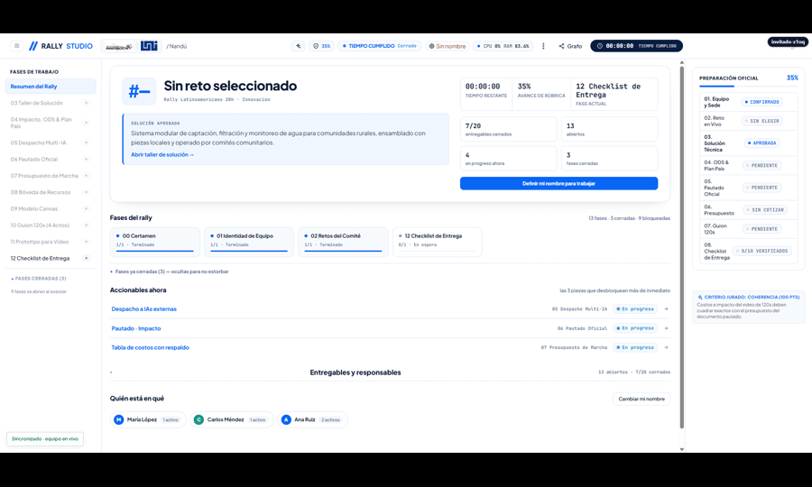
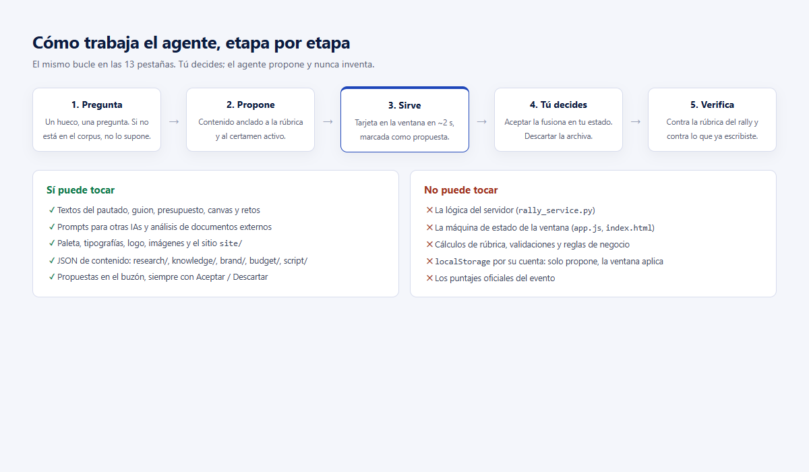
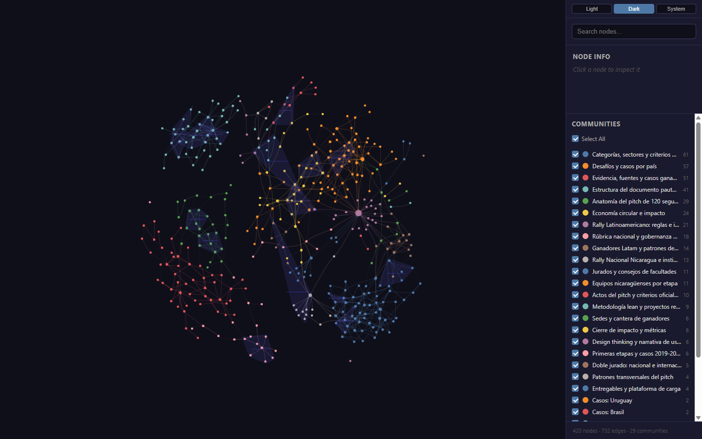

# Rally Studio · Tu Copiloto para el Rally de Innovación

[](#inicio-rapido)
[](#certamenes)
[](#cerebro)
[](#asistentes)
[](#pruebas)

> **Un espacio de trabajo creado por un estudiante universitario que ya vivió y ganó un rally, diseñado para ayudar a otros equipos a no perder la cabeza en maratones de 24h y 28h (Rally Latinoamericano y Rally Nacional Nicaragua Innova). No te promete ganar por arte de magia, pero te ahorra horas de caos, organiza a tu grupo y evita que te descalifiquen por un error tonto.**

<div align="center">


**Instala en 1 minuto y empieza a trabajar:**

```powershell
pip install -r requirements.txt
.\iniciar_rally.ps1
```
Abre en tu navegador: **http://localhost:8000/dashboard/**

</div>

---

## El problema: a las 3:00 AM nadie sabe qué preguntarle a la IA

Durante un rally de 28 horas el equipo no pierde el tiempo programando, pierde el tiempo **decidiendo**: ¿qué reto elegir, cómo justificar el impacto, cuánto cuesta cada pieza, si el video pasa de 120 segundos, si las cifras del documento cuadran con el presupuesto, si el nombre ya existe en otro país. Rally Studio resuelve eso: estructura el trabajo en 13 etapas, te da los prompts listos, revisa los entregables contra la rúbrica y te avisa antes de que te descalifiquen.

---

## El sistema en acción

<div align="center">



*GIF real: pantallas del dashboard — pautado, resumen, arquitectura y flujo de despacho de las IAs.*

</div>

<div align="center">


*Figura 1: Pautado — las cinco secciones del documento técnico con sus límites de caracteres y el cronómetro del certamen.*

</div>

<div align="center">


*Figura 2: Resumen — qué etapa está completa, qué falta y quién se encarga de cada parte.*

</div>

<div align="center">



*Figura 3: Cómo te asisten las IAs — sugerencias en pantalla que aceptas o descartas con un botón; nada se sobrescribe sin tu permiso.*

</div>

---

## Cómo funciona: las 13 etapas, paso a paso

```
[00 Certamen] ──> [01 Equipo] ──> [02 Retos] ──> [03 Solución] ──> [04 Impacto/ODS]
                                                                           │
[09 Canvas]   <── [08 Recursos]<── [07 Budget] <── [06 Pautado] <── [05 Multi-IA]
     │
     └──> [10 Guion 120s] ──> [11 Web Demo] ──> [12 Checklist Final] ──> ¡A tiempo!
```

En cada etapa el sistema hace tres cosas: **pregunta lo que falte**, **propone** (marcado como propuesta) y **verifica** contra la rúbrica del certamen activo. Nunca avanza inventando datos.

---

## El cerebro: mapa de conocimiento de ganadores y rúbricas

<div align="center">



*Figura 4: Grafo del conocimiento — proyectos premiados de años anteriores, rúbricas de evaluación, antecedentes de solución y comunidades detectadas (294 nodos, 272 aristas, 34 comunidades). Puedes abrir el visualizador interactivo en `graphify-out/graph.html`.*

</div>

En lugar de carpetas con documentos sueltos que nadie lee a medianoche:
- Revisa cómo resolvieron problemas técnicos otros equipos universitarios en ediciones anteriores.
- Cada estadística citable vive en `research/claims.json` con fuente, año y URL.
- Si un dato no está en el corpus, el sistema lo dice y te pregunta; no se inventa nada.

---

## Los 16 asistentes (el dream team del desvelo)

Cada asistente tiene un trabajo puntual para que tu equipo se reparta la carga. Todos incluyen ahora bloques de **prompts para otra IA**, **nombrado de proyecto**, **enseñanza visual**, **guion con pronunciación**, **modelos 3D** y **elementos gráficos**.

| Asistente | Nombre de Guerra | Qué hace por ti |
|---|---|---|
| `guiar-usuario` | **Tu Última Neurona** | Te acompaña paso a paso por las 13 etapas para que no te pierdas a las 4 AM. |
| `orquestador` | **El Admin del Grupo** | Reparte las tareas y cuida que tu computadora no se pegue con procesos pesados. |
| `sharktank` | **El Destructor de Sueños** | Analiza tu idea con total sinceridad: busca si ya existe en otro país o qué fallas tiene antes de que pierdas 10 horas. |
| `auditar-entregable` | **La Tóxica que Revisa el Chat** | Busca cualquier contradicción en los números del documento o límites de palabras y te avisa a tiempo. |
| `presupuesto` | **Don Cangrejo (El Palmado)** | Cotiza componentes reales con proveedores y enlaces para que el jurado verifique los precios. |
| `modelo-3d-blender` | **El Quemador de Tostadas** | Arma el modelo 3D y las imágenes para el video basándose en la lista de materiales. |
| `dossier-soluciones` | **Labia Interna** | Estructura propuestas lógicas y creíbles (problema, causa, idea y cómo medirla). |
| `proponer-retos` | **La Ruleta Rusa** | Lee los retos que publica el comité y ayuda al grupo a descartar los más complicados. |
| `ingestar-investigacion`| **La Chismosa del Barrio** | Procesa PDF/DOCX/MD externos y los alinea a la rúbrica. |
| `contexto-rally` | **San Google de los Ganadores** | Recuerda las reglas oficiales y ejemplos ganadores anteriores para no inventar ruedas cuadradas. |
| `publicar-sitio` | **El del Ciber del Barrio** | Te ayuda a subir la web demo a GitHub Pages o Netlify. |
| `servir-a-ventana` | **PedidosYa** | Te muestra las sugerencias en pantalla para que solo tengas que darle a "Aceptar" o "Descartar". |
| `sugerir-por-fase` | **Café Presto con Ansiedad** | Te recuerda cuánto tiempo queda en el reloj para que no dejes todo a última hora. |
| `propuesta-identidad` | **El Diseñador de Carretera Masaya** | Te ayuda a elegir colores y letras que se vean limpias y fáciles de leer. |
| `control-tiempo-entrega` | **—** | Cronómetro, congelamiento de assets al 75 % y checklist SIRLI. |
| `brainstorming` | **—** | Lluvia de ideas antes de crear funcionalidad nueva. |

---

## Pruebas y validación (verificables)

El sistema incluye un arsenal de pruebas de humo que corren sin GPU ni red. Resultado real de `python smoke.py`:

```
SMOKE -- arsenal de Rally Studio

  [PASA] ffmpeg localizado        ...\imageio_ffmpeg\binaries\ffmpeg-win-x86_64-v7.1.exe
  [PASA] medicion de duracion     1.00 s via ffmpeg
  [PASA] caracteres por campo     marcadores y exceso detectados
  [PASA] coherencia de cifras     2 discrepancias, miles normalizados
  [PASA] registro arsenal         arsenal.lock.yaml legible
  [PASA] brief                    brief.json legible (vacio es valido: el cerebro espera)

  6/6 pruebas pasan.
```

Antes de entregar a SIRLI se ejecuta `python arsenal.py check-todo`, que verifica:
- Duración del video ≤ 120 segundos.
- Coherencia de cifras entre guion, pautado y presupuesto.
- Límites de caracteres por campo del pautado.

> **Transparencia:** este es un proyecto independiente de un estudiante universitario basado en su experiencia en competencia. No es una herramienta oficial de ninguna universidad, comité organizador ni institución.

---

## ¿En qué certamen vas a competir?

| Certamen | Tiempo | Moneda | Enfoque Principal |
|---|:---:|:---:|---|
| **Rally Latinoamericano** | **28 h** | **Dólares (USD)** | Solución replicable en varios países de la región, técnica clara y modelo sostenible. |
| **Rally Nacional (Nicaragua Innova)** | **24 h** | **Córdobas (C$)** | Aplicado a un municipio real de Nicaragua, conectado con el Plan Nacional de Lucha contra la Pobreza y ODS relevantes. |

---

## Lo que entregas al final (checklist SIRLI)

- [ ] `brief.json` completo y validado
- [ ] `docs/pautado_draft.docx` — caracteres dentro del límite
- [ ] `budget/budget.xlsx` — rango $4,000–$6,000 USD con URLs de respaldo
- [ ] `docs/canvas.md` — coherente con el presupuesto
- [ ] `script/script.md` — guion 4 actos (PAS-V) ≤ 120 s
- [ ] `assets/voice/narration.mp4` — locución MP4 (AAC) ≤ 120 s
- [ ] Video final en YouTube (URL en `brief.json` → `video_url`)
- [ ] Web demo publicada (URL en `brief.json` → `site_url`)

---

## Llevar el contenido a otra IA (prompts listos)

Cada skill trae un bloque "Generación de prompts para llevar el contenido a otra IA" con rol, contexto, entrada, tarea, restricciones, formato de salida JSON e idioma español. Listo para copiar y pegar en OpenAI, Claude, Gemini, OpenCode o Antigravity.

Ejemplo rápido (guion a otra IA):

```
Rol: guionista de pitch de innovación, especialista en locución y pronunciación en español.
Contexto: Rally de innovación, certamen latam (28 h), acto 3, duración objetivo 40 s.
Entrada: script/script.md, budget/budget.json, research/claims.json.
Tarea: Escribir el acto 3 (Solución) del guion PAS-V, cuidando pronunciación, orden de palabras y flujo de ideas.
Restricciones: ≤ 120 s de audio; números coinciden con budget/budget.json; cada dato de research/claims.json; sin emojis; cierre: "piloto en [ciudad], replicable en toda América Latina".
Formato de salida: JSON con claves acto, nombre, duracion_s, texto, palabras_estimadas, wpm, numeros_coherentes, claims_usados, cierre_certamen.
Idioma: español.
```

---

## Sugerir un título o nombre de proyecto o producto

Sigue los patrones reales del banco SIRLI (`research/sirli/winners.jsonl`):

- **Inventado:** NEXORA, KINETIX
- **Objeto:** AVOCADO, LUMBRE
- **Compuesto:** NEXO-SOSTENIBLE
- **Territorio + número:** ALTIPLANO 360
- **Sufijo técnico:** BIOINNOVATECH
- **Juego:** DESUCHO, ERROR 404

Reglas:
- Nunca repites el nombre del proyecto más de una vez por sección.
- No hardcodees el nombre en scripts; léelo siempre de `brief.json`.
- El nombre debe entenderse fuera del país (Latam) o tener arraigo cultural (Nacional).
- El nombre no va en los primeros 20 s del video.

---

## Enseñar visualmente y elementos gráficos

- Una sola distancia focal por secuencia con rótulos; mide rótulos en pantalla (margen ≥6 %).
- Contraste garantizado: texto claro sobre placa oscura, rótulos siempre con flecha.
- Thumbnail y portada: sin figuras básicas (cuadrados, círculos, triángulos); foto real de la problemática; sin texto/logos/marcas de agua en la imagen; PNG 2048×2048 fondo transparente.
- Sin emojis, sin morado (#7c3aed), sin cards genéricas, sin glassmorphism, fuentes solo de `brand/tokens.css`.
- Assets nombrados: `asset_<shotlist_id>_<descripcion>.<ext>`.

---

## Redactar guiones cuidando la pronunciación y el orden de palabras

- Escribe para ser escuchado: sujeto-verbo-objeto, oraciones cortas, acentos reales en español.
- Pausa o transición por cada cambio de idea.
- Máximo 240-270 palabras (≈130-140 WPM) para ≤ 120 s de audio.
- Números dichos completos; coherencia con `budget/budget.json`; datos de `research/claims.json`.
- Cierre según certamen: Nacional → municipio + Plan Nacional/ODS; Latam → "piloto en [ciudad], replicable en toda América Latina".

---

## Crear modelos 3D (Blender)

La skill `modelo-3d-blender` genera modelos o renders 3D con Blender para el video, con ficha técnica previa justificada por la rúbrica. Resumen:

1. **Confirma la toma** en `script/shotlist.csv` (rubric_item, calidad, duración).
2. **Compila contratos:** `python scripts/build_shotlist.py` sin errores.
3. **Busca antes de modelar:** modelos CC0 o del proyecto; solo modela lo que no existe.
4. **Escribe la ficha** `blender/ficha_<shot_id>.md` y hazla aprobar antes de reservar GPU.
5. **Toma el guardia:** `python scripts/gpu_lock.py run --owner modeler_<pieza> --priority media -- <comando>`.
6. **pre_render_check:** `python scripts/pre_render_check.py <shot_id>` debe salir 0.
7. **Modela con script reproducible**, no a mano. Dimensiones desde `budget/bom.csv`.
8. **Renderiza en el tier de la toma:** draft EEVEE 50 % ≤5 min; EEVEE 100 % ≤20 min; Cycles solo pasado ~75 % del tiempo.
9. **Bucle de crítica (máx. 2 vueltas):** corrige lo que no se lee en cámara.
10. **Entrega:** `dashboard/assets/` como `asset_<shotlist_id>_<descripcion>.<ext>` y anota minutos en `blender/horas_3d.csv`.

---

## Instalación rápida

1. Python 3.10+: `pip install -r requirements.txt`
2. Inicia: `.\iniciar_rally.ps1` (o doble clic en `Iniciar Rally.bat`)
3. Abre: `http://localhost:8000/dashboard/`

Funciona sin internet: guarda todo en tu navegador y en tu computadora; comparte en red local con `python scripts/crear_proyecto.py` y respalda en USB con un archivo `.json`.

---

¿Listo para empezar? Ejecuta `.\iniciar_rally.ps1` y abre el dashboard. Si algo falla, corre `python smoke.py` para verificar que las piezas críticas funcionan en tu máquina.
