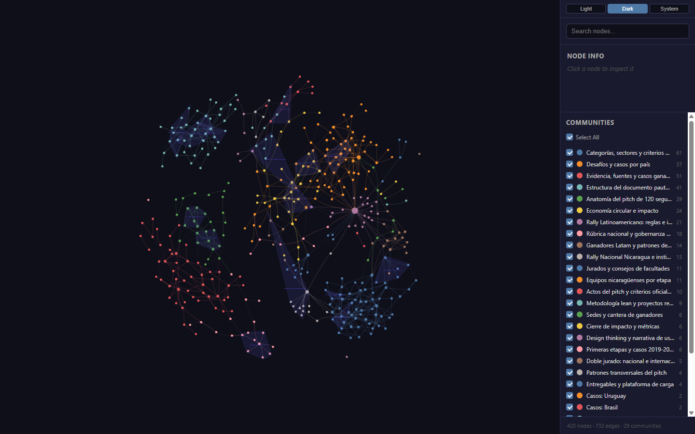

# Cerebro de conocimiento — cómo se construye

Este directorio es la **memoria de dominio** del proyecto: todo lo que un equipo necesita
saber para ganar el rally, sin una sola línea del motor.

```
brain/
  corpus/              ← lo que el cerebro lee (generado, no se edita a mano)
  sync_corpus.py       ← reconstruye corpus/ desde las fuentes canónicas
  corpus_state.json    ← qué entró, qué es manual y si hay proyecto activo
```

Grafo resultante en `graphify-out/`:

| Archivo | Para qué |
|---|---|
| `graph.json` | el grafo (nodos, aristas, comunidades) |
| `graph.html` | visualizador interactivo |
| `GRAPH_REPORT.md` | informe con comunidades, nodos centrales y preguntas |
| `.graphify_labels.json` | nombres de las comunidades |

El recuento de nodos y comunidades vive **solo** en `GRAPH_REPORT.md`: cambia cada vez
que se reconstruye el grafo, así que no se copia aquí (una cifra escrita a mano en dos
sitios acaba siendo falsa en uno de los dos).

## Qué entra y qué no

**Entra** conocimiento que gana: rúbricas oficiales (texto e imagen), banco de retos,
análisis de ganadores 2014–2026, casos internacionales, patrones de pitch, claims con
fuente, estructura del pautado y del video de 120 s.

**No entra** (y es deliberado):

| Excluido | Por qué |
|---|---|
| `scripts/`, `dashboard/`, `site/` | el motor no se programa: lo opera el usuario |
| `LEEME.md`, `docs/INSTALACION_AGENTE.md` | instrucciones de arranque, no conocimiento |
| `graphify-out/converted/` | pautados de ediciones anteriores (regla 11 de `AGENTS.md`) |
| capturas sueltas de WhatsApp | ruido sin valor probatorio |

El grafo anterior tenía 177 nodos y **33 % de ellos eran ruido**: una foto de WhatsApp,
dos proyectos muertos y el LEEME. Ese ruido generó comunidades fantasma como
«Proyecto Güegüense Pinolero» o «Sede UNAN-León» que no aportaban nada al equipo.

## Un tema, un archivo

El extractor trabaja **por archivo**: cada documento forma sus propias comunidades y
solo se cruza con los demás por fusión de entidades. Por eso el corpus no se sirve en
trozos gigantes ni en formatos que el grafo no sabe leer:

- **JSON como documento.** Los `.json` se convierten a Markdown (`JSON_DOCS`). Si entran
  como `.json`, graphify los pasa por AST y produce nodos basura. Así entran el banco de
  retos, los claims, los ganadores por fase y `retos_razonamiento.json` (101 casos con
  problema, causa, solución y puesto) como `casos_ganadores.md`.
- **Instancias separadas.** `knowledge/winners_latam.md` mezclaba el podio continental y
  las 363 filas nacionales en un solo archivo de 127 KB. `sync_corpus.py` lo parte
  (`SPLIT`) en `ganadores_latam_internacional.md` (68 filas de podio) y
  `ganadores_nacional.md`. Rally Latinoamericano y Rally Nacional son certámenes
  distintos: se citan, se evalúan y se preguntan por separado.
- **Nombres ASCII.** Los IDs de nodo salen de la ruta; los acentos en el nombre del
  archivo producen ids ilegibles.

## Archivos manuales

Estos viven en `brain/corpus/` y `sync_corpus.py` **no los produce**: son curados a mano
(`MANUAL` en el script). Aparecen en `corpus_state.json` para que el recuento sea veraz.

`ganadores_cruzados.md`, `transcripciones_primeros_lugares_nic.md`, `videos_sin_audio.md`,
`informe_estado_nic_transcripciones.md`, `winners_sirli.md`.

## Reconstruir el cerebro

```powershell
# 1. Sincronizar corpus (copia, convierte y parte desde knowledge/, research/ y docs base)
python brain/sync_corpus.py

# 2. Reconstruir el grafo (asistente con la skill graphify)
/graphify brain/corpus
```

`sync_corpus.py` es idempotente: puedes correrlo las veces que quieras. Deduplica,
convierte `.docx` y `.json` a Markdown, parte las fuentes con dos instancias, borra los
archivos que generó una versión anterior (`OBSOLETOS`) y nunca borra
`proyecto_actual.md`.

## El proyecto real: el cerebro espera

El cerebro se distribuye **sin proyecto**. Eso es intencional: cada usuario corre el
sistema con su propio reto y su propio equipo.

El cerebro incluye el proyecto cuando se cumple esta condición:

1. `brief.json` tiene `project_name`, `team_name`, `university` y `city` con valor.
2. Existe `brain/corpus/proyecto_actual.md` con el brief, la solución y el pautado.

Mientras el archivo no exista, el cerebro solo contiene conocimiento del certamen.
Cuando el usuario define su proyecto, el agente lo crea y corre:

```powershell
graphify update brain/corpus
```

Regla para el agente (también en `AGENTS.md`): **no inventar un proyecto**. Si
`brief.json` está vacío, el cerebro se queda esperando y se le dice al usuario que
defina su reto. Nunca se rellena con un proyecto de ejemplo.

## Consultarlo

El grafo no es solo un dibujo: es el índice de búsqueda. Antes de abrir documentos a
ciegas, pregunta por el tema:

```powershell
graphify query "rubrica de evaluacion" --graph brain/corpus/graphify-out/graph.json
```

Devuelve los nodos que tratan el tema con su archivo y su línea. Es local y no cuesta
API. El informe vivo (nodos, aristas, comunidades) está en
`brain/corpus/graphify-out/GRAPH_REPORT.md`.

## Enlazar un documento nuevo

Cada documento del corpus cierra con un bloque `## Relacionado` que apunta a sus vecinos
con una razón. No se escribe a mano: se declara en el mapa `RELACIONADO` de
`sync_corpus.py` y la siguiente corrida lo reescribe. Ese bloque es lo que convierte 36
archivos sueltos en una sola red (las aristas `references` del grafo). Un documento sin
vecinos declarados queda aislado, y el cerebro no puede llevarte de un tema al siguiente.

## Fusión de entidades

`sync_corpus.py` deja el corpus listo, pero la extracción se hace por archivo, así que
la misma idea puede aparecer con ids distintos. Al reconstruir se aplica una pasada de
resolución de entidades (fusión por etiqueta normalizada) y se descartan aristas
colgantes o duplicadas antes de construir el grafo. Sin ese paso el grafo no cruza
documentos y pierde justo lo que lo hace útil.

<div align="center">



*Figura: grafo del conocimiento compilado. Cifras vigentes en `graphify-out/GRAPH_REPORT.md`;
visualizador interactivo en `graphify-out/graph.html`.*

</div>
