# Instalación de la capa de agente (b)

Esta guía deja el repositorio listo para que lo abras con **OpenCode** o con
**Antigravity** y la IA ya sepa qué es el proyecto, cómo guiar al usuario y cómo servir
contenido a la ventana.

No hace falta ninguna clave API ni ninguna cuenta de pago. El motor es la IA de
programación que ya tienes instalada.

---

## 1. Requisitos

- Windows 10/11 (macOS/Linux también sirven, ver §7).
- **Python 3.10 o superior**, con *Add Python to PATH* marcado.
- Una de las dos herramientas: **OpenCode** (`npm i -g opencode-ai`) o **Antigravity**.
- Opcional: `npx` (viene con Node) si quieres el MCP de Playwright.

---

## 2. Instalación en una pasada

```powershell
.\scripts\setup_agente.ps1
```

El script, en este orden:

1. Comprueba Python y su versión.
2. Instala `requirements.txt` (los opcionales pesados — `easyocr`, `chatterbox-tts`,
   `kokoro`, `ffmpeg` — **no** se instalan solos).
3. Refleja cada carpeta de `skills/` en `.opencode/skills/` y `.agents/skills/`
   (por *junction*; si el sistema no lo permite, por copia).
4. Declara el MCP de Playwright en `opencode.json`, sin borrar los MCPs que ya tengas.
5. Arranca el servidor en un puerto libre y comprueba `/health`.

Es **idempotente**: si lo corres dos veces, la segunda no cambia nada y lo dice.

Banderas útiles:

| Bandera | Qué hace |
|---|---|
| `-SinDependencias` | No toca `pip`. |
| `-SinVerificarServidor` | No arranca el servidor al final. |

---

## 3. Dónde vive cada cosa

| Pieza | Ruta | Quién la lee |
|---|---|---|
| Contrato de entrada | `AGENTS.md` (raíz) | OpenCode **y** Antigravity |
| Reglas profundas por tema | `.agents/rules/*.md` | Antigravity (OpenCode las ignora sin daño) |
| Skills (fuente única) | `skills/<nombre>/SKILL.md` | — |
| Skills para OpenCode | `.opencode/skills/<nombre>/` | OpenCode |
| Skills para Antigravity | `.agents/skills/<nombre>/` | Antigravity |
| Índice del corpus | `knowledge/INDICE.md` | la IA, al arrancar |
| MCP de OpenCode | `opencode.json` (raíz) | OpenCode |
| MCP de Antigravity | `~/.gemini/…` (global) | Antigravity |

`skills/` es la **única** fuente de verdad. Las dos carpetas de destino son reflejos que
crea el instalador: no las edites a mano, y no las commitees.

---

## 4. Los dos caminos

### 4.1 OpenCode

- Lee `AGENTS.md` de la raíz automáticamente.
- Descubre las skills en `.opencode/skills/`.
- Toma los MCPs de `opencode.json` del proyecto (ya viene con Playwright).

No hay que hacer nada más: abre la carpeta y listo.

### 4.2 Antigravity

- Lee `AGENTS.md` de la raíz como regla siempre activa.
- Lee `.agents/rules/*.md` por *progressive disclosure*.
- Descubre las skills en `.agents/skills/` (mantiene compatibilidad con `.agent/skills`).
- **La configuración de MCP es global**, no de proyecto: vive en `~/.gemini/…`.

Para el MCP de Playwright en Antigravity, añade la entrada en su configuración global
siguiendo la documentación de Antigravity (`Settings → MCP`). El instalador **no** toca esa
configuración: es global y afecta a todos tus proyectos.

Sin MCP de Playwright la IA sigue funcionando; solo pierde la capacidad de navegar y
capturar pantallas por sí sola.

---

## 5. Límites de Antigravity que condicionan este repo

Antigravity corta las reglas por tamaño. Por eso el repo está partido así:

- **24 000 bytes por archivo de regla.** Si un archivo se pasa, se trunca.
- **~20 000 tokens agregados** para reglas globales y `always_on`. Si se excede,
  Antigravity degrada los archivos más grandes a un simple puntero.
- Por eso `AGENTS.md` es corto y apunta al resto; el detalle vive en `.agents/rules/` y en
  `skills/`, que se cargan solo cuando hacen falta.

Si añades texto a `AGENTS.md`, mide: `(Get-Item AGENTS.md).Length`. Hay una prueba
(`tests/test_agent_layer.py`) que falla si pasa de 24 000 bytes.

---

## 6. MCP de Blender (opcional)

Solo si vas a generar modelos 3D desde la IA.

- Paquete comunitario: `ahujasid/mcp-for-blender` (MIT, gratis).
- Requiere **Blender 3.0 o superior** y el addon instalado en
  `Edit → Preferences → Add-ons`, con *Allow Online Access* activado.
- Advertencia: ejecuta código en Blender **sin guardas**. Úsalo solo en tu máquina y solo
  cuando la tarea lo pida.

No viene instalado por defecto a propósito: cada MCP extra es una fuente de fallos.

---

## 7. macOS y Linux

El instalador es PowerShell. En macOS/Linux hazlo a mano:

```bash
python3 -m venv .venv && source .venv/bin/activate
pip install -r requirements.txt
mkdir -p .opencode/skills .agents/skills
for d in skills/*/; do
  n=$(basename "$d")
  ln -sfn "$(pwd)/$d" ".opencode/skills/$n"
  ln -sfn "$(pwd)/$d" ".agents/skills/$n"
done
python3 scripts/rally_service.py
```

`opencode.json` ya trae el MCP de Playwright y funciona igual.

---

## 8. Abrir el workbench con candado (túnel)

<div align="center">
  
</div>

El motor se queda en tu computadora: ahí vive la IA de `opencode` y ahí están `dashboard/data/` y los assets. El HTTPS lo pone un túnel, así que los teléfonos entran por una dirección `https://` normal sin instalar certificados.

```powershell
python scripts/rally_service.py
cloudflared tunnel --url http://localhost:8000
```

La segunda consola imprime `https://algo.trycloudflare.com`. Esa dirección, con `?t=<invitación>`, es la que se comparte. Dura lo que dure el proceso: si se reinicia, cambia y hay que repartir el link otra vez. Para una dirección fija, túnel con nombre de Cloudflare y dominio propio.

Qué cambia y qué no:

| | Sin túnel | Con túnel |
|---|---|---|
| Cifrado | ninguno (texto plano en el WiFi) | HTTPS de extremo a extremo: navegador → túnel |
| Llave maestra | solo desde la computadora | igual: el túnel devuelve `llave-solo-local` (403) |
| IP del visitante | la del WiFi | la real, leída de `X-Forwarded-For` |
| Datos y IA | en tu máquina | igual, en tu máquina |
| Usuarios | con aprobación del admin | igual, la aprobación no se salta |

Variables que conviene tocar al abrir el enlace:

| Variable | Para qué |
|---|---|
| `RALLY_AI_USER_RATE_LIMIT=20` | techo de pedidos de IA por persona (por defecto 0 = sin techo) |
| `RALLY_TRUST_PROXY=0` | desconfía de la cabecera del proxy (todo se ve como local) |
| `RALLY_TRUST_PROXY=1` | fuerza a creer la cabecera aunque el túnel viva en otra máquina |

La cabecera `X-Forwarded-For` solo se cree cuando la conexión viene de la propia máquina —que es donde corre el túnel—; un vecino del WiFi no puede hacerse pasar por local. Si alguien cambia de red (WiFi → datos), la sesión queda atada a la IP anterior: vuelve a entrar con su clave.

---

## 9. Si algo falla

| Síntoma | Qué revisar |
|---|---|
| La IA no menciona el flujo | ¿Está `AGENTS.md` en la raíz? ¿Lo estás abriendo como carpeta del proyecto? |
| No aparecen las skills | Corre otra vez el instalador; revisa que `.opencode/skills/` y `.agents/skills/` tengan las carpetas. |
| Antigravity ignora una regla | Falta el frontmatter `trigger:` en `.agents/rules/*.md`, o el archivo pasa de 24 000 bytes. |
| El servidor no responde | `python scripts/rally_service.py` a mano y mira la consola. ¿Puerto ocupado? |
| La ventana no muestra propuestas | ¿Está el servidor Python levantado? Sin servidor, el buzón no existe (y la ventana lo avisa). |
| `pip install` falla | Usa un entorno virtual: `python -m venv .venv` y actívalo. |
| La llave maestra no abre desde el link del túnel | Es a propósito (`llave-solo-local`): se entra con ella en la computadora del servidor y de ahí salen las invitaciones. |
| `cloudflared` no está | `winget install Cloudflare.cloudflared` y vuelve a abrir la consola. |
| El link del túnel abrió y luego murió | Los túneles rápidos de Cloudflare cambian de dirección al reiniciar: vuelve a leer la consola. |

---

## 10. Qué queda listo al terminar

- La IA sabe quién es, qué certamen corre y qué debe existir en cada una de las 13 etapas.
- Sabe qué tocar (contenido y presentación) y qué no (el motor).
- Tiene las 10 skills y las 4 reglas profundas a mano.
- Puede servir propuestas a la ventana en tiempo real.
- Tiene el índice del corpus para no leer 2 MB de PDFs en balde.
